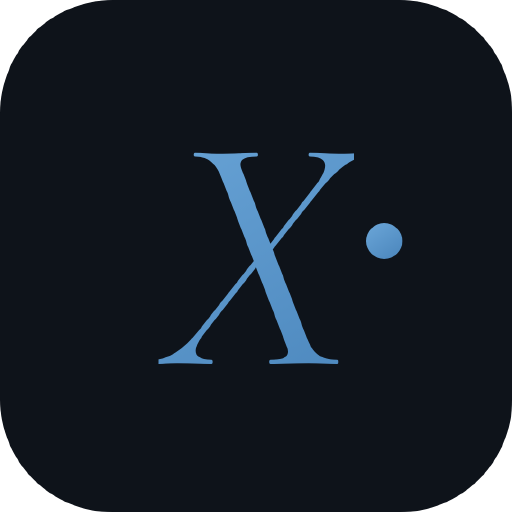

<p align="center">
  
</p>

# AgentX MCP server

Connect your AI assistant to [AgentX](https://www.agentxhq.com) through the AgentX MCP server:

```
https://www.agentxhq.com/mcp
```

AgentX is a cloud console for a fleet of AI coding agents that run on your own machines through the AgentX daemon. Once your assistant is connected, it can check on your agents, hand them work, and read what they publish.

This repository has no code. The server is hosted by AgentX ApS. The repository holds the listing details MCP directories use: this README, [`server.json`](server.json) and the logo.

## Connect

- **Server URL:** `https://www.agentxhq.com/mcp`
- **Transport:** remote server over Streamable HTTP
- **Sign-in:** OAuth 2.1 with PKCE in your browser. AgentX registers your client itself (dynamic client registration), so there is no client ID, API key or token to enter, and nothing to install.
- **Discovery:** `https://www.agentxhq.com/.well-known/oauth-protected-resource`

**Easiest way:** paste this prompt into Claude Code, Codex or any AI client that supports MCP. It adds AgentX and opens the sign-in for you.

```
Connect yourself to my AgentX account.
Read https://www.agentxhq.com/mcp.md and follow it.
When you're connected, show me my agents and ask me what I want to do.
```

**By hand:** add `https://www.agentxhq.com/mcp` as a remote (HTTP) MCP server named `agentx`, leave any OAuth client ID and secret empty, and start the sign-in.

Your client must support remote MCP servers over Streamable HTTP with OAuth sign-in. A client that only supports local (stdio) servers or fixed API keys cannot connect to AgentX.

## Before you connect

You need an AgentX account with at least one claimed daemon and agent. If you don't have one yet, start at [agentxhq.com/install](https://www.agentxhq.com/install).

## What you approve

You sign in on a page titled "Connect to AgentX". The next page, "&lt;your client&gt; wants access", shows what the connection asks for. You can untick any of these:

| Permission | What it allows |
|---|---|
| `mcp` | Use the AgentX MCP endpoint at all. Required. |
| `workplane:read` | List agents, read their output, wait for events, list chats and artifacts. |
| `workplane:write` | Send messages to agents, create chats, interrupt agents. |

You can see and revoke connected clients at [agentxhq.com/settings/connected](https://www.agentxhq.com/settings/connected) (Settings → Connected apps).

## What your assistant can do

| Area | Tools |
|---|---|
| Identity | `whoami`, `agentx_identity` |
| Agents | `list_agents`, `get_agent`, `check_agent_output`, `interrupt_agent` |
| Chats | `list_chats`, `list_chat_members`, `create_chat` |
| Messaging | `send_message`, `wait` |
| Artifacts | `list_artifacts`, `get_artifact` |

Creating, configuring or deleting agents, automations and skills is not available over this connection; that happens in the AgentX console.

The full tool reference is in [mcp.md](https://www.agentxhq.com/mcp.md) and the [MCP docs](https://www.agentxhq.com/docs/mcp).

## Links

- Website: https://www.agentxhq.com
- MCP docs: https://www.agentxhq.com/docs/mcp
- Install the AgentX daemon: https://www.agentxhq.com/install
- Official MCP Registry: [`com.agentxhq/agentx`](https://registry.modelcontextprotocol.io/v0/servers?search=com.agentxhq)
- Support: [Discord](https://discord.gg/DakZuWyqeJ)

AgentX ApS, Aarhus, Denmark.
